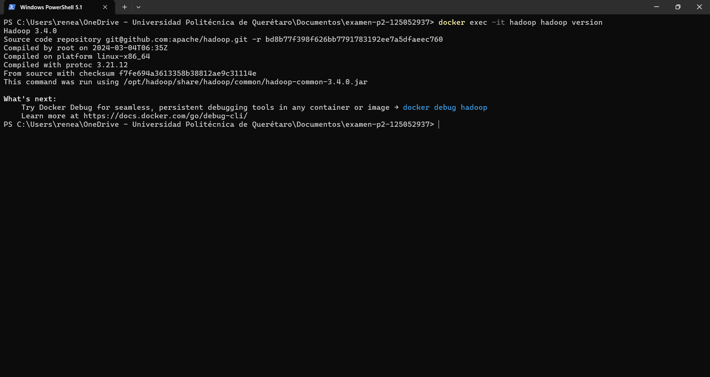
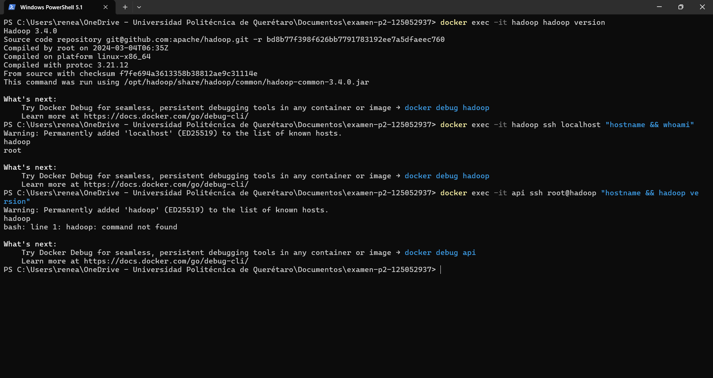
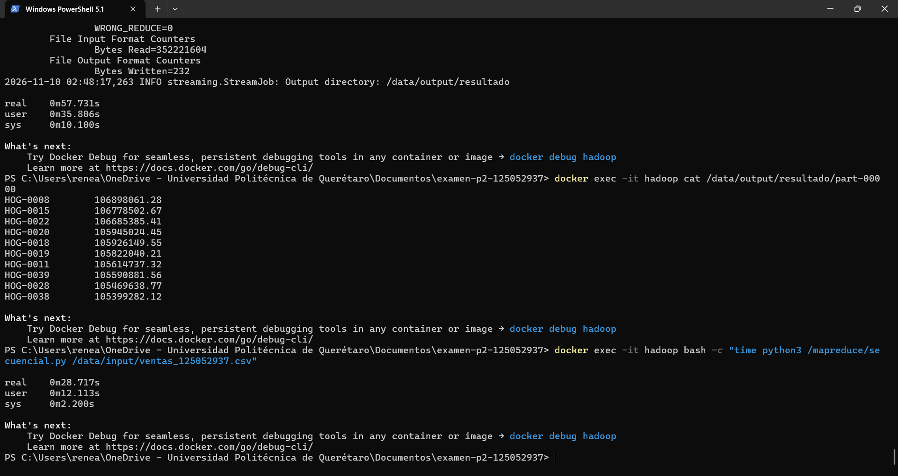
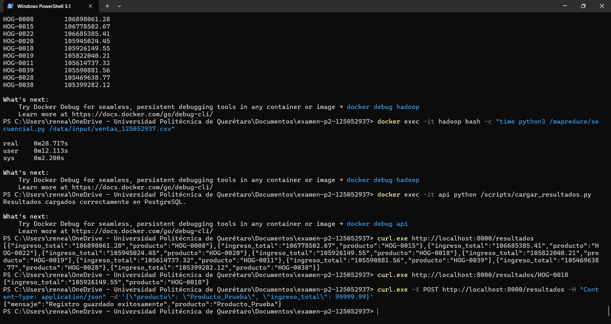

# Examen Segundo Parcial

- **Alumno:** René Nicolas Acosta López
- **Matrícula:** 125052937 (Último dígito: `7`)
- **Materia:** Manejo Masivo de Datos
- **Pregunta de negocio asignada:** Top 10 productos por ingreso total (`cantidad * precio_unitario`) en todo el año.

---

## 1. Estructura del Proyecto

```text
examen-p2-125052937/
├── README.md
├── .gitignore
├── .env.example
├── docker-compose.yml
├── hadoop/
│   └── Dockerfile
├── mapreduce/
│   ├── mapper.py
│   ├── reducer.py
│   └── secuencial.py
├── api/
│   ├── Dockerfile
│   ├── requirements.txt
│   └── app.py
├── scripts/
│   └── cargar_resultados.py
└── evidencias/
```

---

## 2. Pasos para levantar y reproducir el entorno

1. **Generar el dataset:** Ejecutar `python generar_dataset.py 125052937` y mover el archivo generado a la ruta `data/input/ventas_125052937.csv`.
2. **Variables de entorno:** Copiar el archivo de ejemplo para crear el archivo `.env`:
   ```powershell
   Copy-Item .env.example .env
   ```
3. **Levantar los contenedores:** Construir e iniciar los servicios (`hadoop`, `db` y `api`) con un solo comando:
   ```powershell
   docker compose up --build -d
   ```
4. **Preparar permisos de los scripts de MapReduce:**
   ```powershell
   docker exec -it hadoop bash -c "sed -i 's/\r$//' /mapreduce/*.py && chmod +x /mapreduce/*.py"
   ```
5. **Verificar instalación de Hadoop y conexión SSH sin contraseña:**
   ```powershell
   docker exec -it hadoop hadoop version
   docker exec -it hadoop ssh localhost "hostname && whoami"
   docker exec -it api ssh root@hadoop "hostname && hadoop version"
   ```
6. **Ejecutar el Job de MapReduce con Hadoop Streaming:**
   ```powershell
   docker exec -it hadoop rm -rf /data/output/resultado
   docker exec -it hadoop bash -c "time hadoop jar `$HADOOP_HOME/share/hadoop/tools/lib/hadoop-streaming-*.jar -input /data/input/ventas_125052937.csv -output /data/output/resultado -mapper 'python3 /mapreduce/mapper.py' -reducer 'python3 /mapreduce/reducer.py'"
   docker exec -it hadoop cat /data/output/resultado/part-00000
   ```
7. **Ejecutar el script secuencial para comparar tiempos y resultados:**
   ```powershell
   docker exec -it hadoop bash -c "time python3 /mapreduce/secuencial.py /data/input/ventas_125052937.csv"
   ```
8. **Cargar los resultados a PostgreSQL y consultar la API:**
   ```powershell
   docker exec -it api python /scripts/cargar_resultados.py
   curl.exe http://localhost:8000/resultados
   curl.exe http://localhost:8000/resultados/DEP-0037
   curl.exe -X POST http://localhost:8000/resultados -H "Content-Type: application/json" -d '{\"producto\": \"PROD-TEST\", \"ingreso_total\": 99999.99}'
   ```
9. **Verificar persistencia de la base de datos:**
   ```powershell
   docker compose down
   docker compose up -d
   curl.exe http://localhost:8000/resultados
   ```

---

## 3. Comparativa de Rendimiento (Parte C2)

| Método de Procesamiento | Tiempo Real Medido (`time`) | ¿Resultados idénticos? |
| :--- | :---: | :---: |
| **Hadoop Streaming (MapReduce)** | `[57.731] s` | Sí |
| **Script Secuencial en Python (`secuencial.py`)** | `[28.717] s` | Sí |

### Explicación de la diferencia de tiempos
En este escenario con un archivo de ~400 MB (5 millones de registros) procesado en un único contenedor en modo standalone, el script secuencial en Python resulta más rápido porque lee el archivo directamente del flujo de disco y acumula los valores en un diccionario en memoria RAM sin capas intermedias. Por el contrario, Hadoop MapReduce mediante Hadoop Streaming introduce una sobrecarga (*overhead*) importante al inicializar la Máquina Virtual de Java (JVM), crear subprocesos externos en Python comunicados por tuberías estándar (`stdin`/`stdout`), serializar y deserializar cada línea como texto, y realizar la fase de ordenamiento y particionado en disco (*Shuffle & Sort*) antes de entregar los datos al `reducer.py`.

---

## 4. Evidencias de Ejecución

### A. Verificación de `hadoop version`


### B. Acceso SSH sin contraseña (`localhost` y desde `api` hacia `hadoop`)


### C. Ejecución y salida del Job MapReduce vs. Script Secuencial


### D. Respuesta de la API (`GET`, `POST`) y Persistencia de Datos


---

## 5. Parte E. Teoría

**1. Explica la diferencia entre los modos standalone, pseudo-distribuido y totalmente distribuido de Hadoop. ¿En cuál de ellos se usa HDFS?**
En el modo **standalone** todo se ejecuta dentro de un único proceso Java (una sola JVM) sin levantar demonios y utilizando el sistema de archivos local del sistema operativo, siendo útil para depuración local. En el modo **pseudo-distribuido** cada demonio de Hadoop (`NameNode`, `DataNode`, `ResourceManager`, `NodeManager`) corre en una JVM separada pero dentro de un mismo nodo o contenedor. En el modo **totalmente distribuido** los demonios se reparten en un clúster real de múltiples servidores físicos o virtuales. **HDFS se utiliza tanto en el modo pseudo-distribuido como en el modo totalmente distribuido**.

**2. ¿Por qué el dataset se monta como volumen y no se copia dentro de la imagen con `COPY`? Menciona al menos dos razones.**
1. **Eficiencia y tamaño de la imagen:** Copiar un archivo de 400 MB con `COPY` inflaría innecesariamente el peso de la imagen de Docker, haría lento el envío del contexto de construcción (`docker build`) y obligaría a reconstruir la imagen cada vez que el dataset cambie.
2. **Desacoplamiento y buenas prácticas de seguridad:** Separar el código/infraestructura de los datos permite procesar distintos archivos cambiando solo el volumen montado y evita subir datos masivos o sensibles al repositorio Git o a Docker Hub.

**3. ¿Qué ocurre con los datos de la base de datos al ejecutar `docker compose down`? ¿Y con `docker compose down -v`?**
Al ejecutar `docker compose down`, Docker detiene y elimina los contenedores y las redes creadas, pero **conserva intacto el volumen nombrado** (`db_data`), por lo que al volver a levantar con `docker compose up` todos los registros siguen en PostgreSQL. En cambio, al ejecutar `docker compose down -v`, el parámetro `-v` elimina explícitamente los volúmenes nombrados asociados al proyecto, destruyendo de forma permanente los datos guardados en la base de datos.

**4. ¿Por qué MapReduce no siempre es más rápido que un script secuencial con un archivo de 400 MB? ¿A partir de qué condiciones conviene?**
Con un archivo de 400 MB en un solo nodo, el tiempo invertido por Hadoop en levantar la JVM, gestionar entradas/salidas por `stdin/stdout` y ordenar en disco durante la fase de *Shuffle & Sort* supera el tiempo que tarda un script secuencial en leer el archivo en memoria RAM. MapReduce conviene cuando el volumen de datos supera la capacidad de memoria y disco de una sola máquina (decenas de GB, Terabytes o Petabytes) y se ejecuta en un **clúster distribuido de múltiples nodos**, donde paralelizar el trabajo divide el tiempo total de cómputo.

**5. Diferencia entre `CMD` y `ENTRYPOINT`, y entre `COPY` y `ADD`.**
`ENTRYPOINT` define el comando ejecutable principal e inmutable que correrá el contenedor al arrancar, mientras que `CMD` define los argumentos por defecto para ese `ENTRYPOINT` (o el comando por defecto que puede ser reemplazado fácilmente al pasar argumentos en `docker run`). Por otro lado, `COPY` se encarga exclusivamente de copiar archivos y carpetas locales del host al contenedor de forma transparente, mientras que `ADD` además permite descargar archivos desde URLs remotas y descomprimir automáticamente archivos comprimidos (`.tar`, `.tar.gz`) locales en el destino.